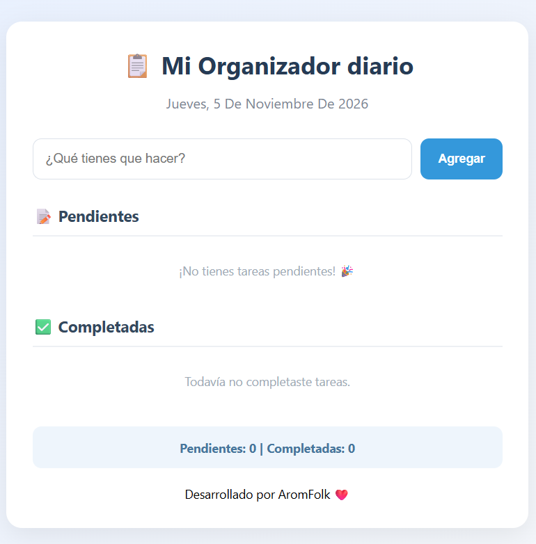

📋 Task Organizer

A simple and intuitive web application built to organize, manage, and keep track of daily tasks.

✨ Features
➕ Add new tasks.
🗑️ Delete tasks.
✅ Mark tasks as completed.
📌 Organize daily activities.
🎨 Simple and user-friendly interface.

🛠️ Technologies Used
HTML5 – Application structure.
CSS3 – Styling and responsive design.
JavaScript – Functionality and interactivity.

📸 Screenshots

🚀 Getting Started
Clone the repository
bash
git clone https://github.com/YOUR-USERNAME/task-organizer.git

Navigate to the project folder
bash
cd task-organizer

Run the application

Open the index.html file in your preferred web browser.

📂 Project Structure

task-organizer/
│
├── index.html
├── style.css
├── script.js
└── README.md

🎯 Purpose

This project was developed to practice and strengthen front-end development skills using HTML, CSS, and JavaScript while creating a practical task management application.

👨‍💻 Author

Developed by Arom Pardo.

⭐ If you like this project, feel free to give it a star!